<!-- ═══════════════════════ HEADER ═══════════════════════ -->

 

  

 

<!-- ═══════════════════════ ABOUT ═══════════════════════ -->

 

Software engineer specializing in **AI-driven systems and full-stack development**. I design and ship complete products end to end — from automated data pipelines and RAG architectures to polished, real-time frontends.

> [!NOTE]
> **AI Track Winner — Berlin Robotics & Agentic AI Hackathon.**
> Led a 6-person team to design, build, and deploy **SERVANAUT**, a real-time market-intelligence platform, end-to-end in a 36-hour sprint.

<table>
<tr>
<td>🦇 <b>Agentic AI Engineering</b></td>
<td>Multi-agent routing, RAG pipelines, LLM orchestration & automation workflows</td>
</tr>
<tr>
<td>⚙️ <b>Full-Stack Development</b></td>
<td>React frontends, Node.js / Spring Boot / FastAPI backends, relational data design</td>
</tr>
<tr>
<td>📡 <b>Real-Time Systems</b></td>
<td>Streaming pipelines, event-driven architecture, high-concurrency processing</td>
</tr>
<tr>
<td>🛡️ <b>Security Mindset</b></td>
<td>Threat monitoring, detection engineering & secure development practices</td>
</tr>
</table>

<!-- ═══════════════════════ TECH STACK ═══════════════════════ -->

## Utility Belt

**Languages**

**Frameworks & Runtime**

**Data, Cloud & Tools**

**AI & Automation**

<!-- ═══════════════════════ PROJECTS ═══════════════════════ -->
## Case Files

<table>
<tr>
<td width="50%" valign="top">

### 🏆 SERVANAUT
*Award-winning market intelligence platform*

Real-time dashboard for robotics founders: live news feed, AI event discovery, competitor watchlist & automated market alerts — continuously refreshed by automated pipelines.

`n8n` `Apify` `Mistral AI` `Supabase` `React`

**→ Winner, AI Track — Berlin Hackathon** · [**Repo**](https://github.com/youssef-110/servanaut-v2)

</td>
<td width="50%" valign="top">

### 🤖 CodePulse
*AI code review dashboard*

Analyzes any public GitHub repo and returns structured feedback on security, quality & performance. Custom file-ranking algorithm maximizes LLM context quality within token limits.

`Node.js` `Express` `Groq (Llama 3.3 70B)` `GitHub API`

[**→ View Repository**](https://github.com/youssef-110/codepulse)

</td>
</tr>
<tr>
<td width="50%" valign="top">

### 🌐 ThreatPulse
*Real-time cyber intelligence*

Live threat monitoring with a **3D WebGL globe** rendering attack arcs between nations, attack-type breakdowns & frequency charts. Fully client-side, zero backend.

`JavaScript` `WebGL` `GSAP` `Vercel`

</td>
<td width="50%" valign="top">

### ⚔️ Abyss Watcher
*High-concurrency Discord bot*

Modular bot with an LLM-powered AI persona, XP leveling with canvas-generated rank cards, streak tracking & a full moderation suite.

`Node.js` `discord.js v14` `Groq` `Supabase`

[**→ View Repository**](https://github.com/youssef-110/discord-moderation-Ai-bot-)

</td>
</tr>
<tr>
<td width="50%" valign="top">

### 🧠 MindSpace
*Full-stack AI platform*

Collaborative personality-test & community app with a **custom RAG pipeline** embedding and indexing user data for context-aware AI insights.

`Python` `FastAPI` `React/Vite` `Supabase`

[**→ View Repository**](https://github.com/youssef-110/MindSpace-FullStack-Core)

</td>
<td width="50%" valign="top">

### 🔀 Prompt-Router
*Dual-layer AI routing system*

C++ CLI gateway + Chrome extension routing prompts to different AI backends via prefix commands — including a `//council` multi-agent debate mode.

`C++` `JavaScript` `Chrome Extension` `Gemini API`

[**→ View Repository**](https://github.com/youssef-110/Prompt-Router)

</td>
</tr>
</table>

<!-- ═══════════════════════ STATS ═══════════════════════ -->

## Surveillance Feed

  

  

<picture>
  <source media="(prefers-color-scheme: dark)" srcset="https://raw.githubusercontent.com/youssef-110/youssef-110/output/github-snake-dark.svg" />
  
</picture>

<!-- ═══════════════════════ CERTIFICATIONS ═══════════════════════ -->
## Training Log

| Certification | Issuer |
|:---|:---:|
| 🧠 Machine Learning with Python | freeCodeCamp |
| 🔬 Scientific Computing with Python | freeCodeCamp |
| ⚡ What Is Generative AI? | LinkedIn Learning |

 

<!-- ═══════════════════════ FOOTER ═══════════════════════ -->

